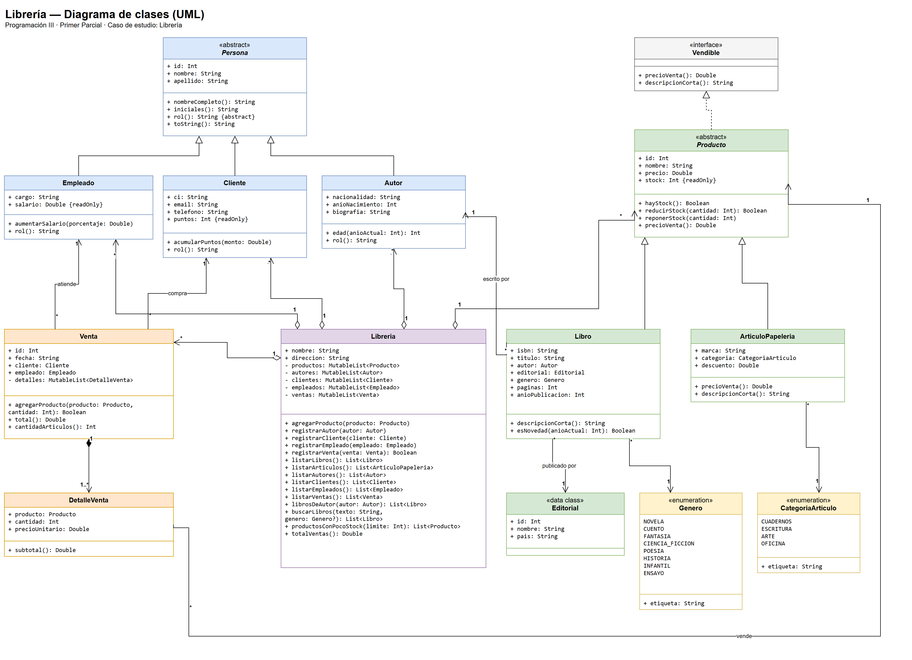
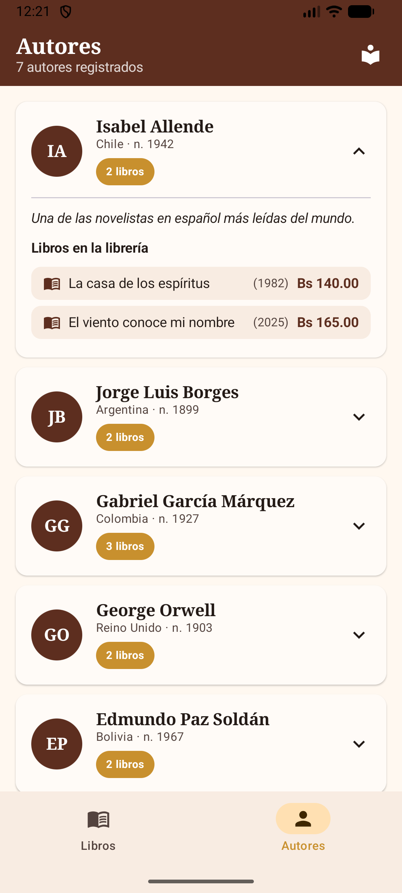

# Librería — Primer Parcial · Programación III

Aplicación Android en **Kotlin + Jetpack Compose** para el caso de estudio **Librería**.

| Checkpoint | Entregable | Ubicación |
|---|---|---|
| 1 – Diseño de clases | Diagrama UML (draw.io + PNG) y análisis | [`docs/checkpoint1`](docs/checkpoint1) |
| 2 – Implementación | Clases del modelo en Kotlin (POO) + datos de ejemplo + pruebas unitarias | [`app/src/main/java/com/upb/libreria/model`](app/src/main/java/com/upb/libreria/model) |
| 3 – Scripts | Prompts de IA, generadores de diagramas draw.io y scripts de compilación/ejecución | [`scripts`](scripts) |
| 4 – Diseño de interfaz | Bocetos de las 2 pantallas (draw.io + PNG) con los componentes de Jetpack Compose | [`docs/checkpoint4`](docs/checkpoint4) |
| 5 – Interfaz | Pantallas Libros y Autores en Jetpack Compose | [`docs/checkpoint5`](docs/checkpoint5) · [`app/.../ui`](app/src/main/java/com/upb/libreria/ui) |
| 6 – Compilación y ejecución | Build + pruebas + capturas en el emulador | [`docs/checkpoint6`](docs/checkpoint6) |

## Vista previa

| Diagrama de clases | Pantalla Libros | Pantalla Autores |
|---|---|---|
|  |  |  |

## Cómo ejecutar

1. Abrir la carpeta del proyecto en **Android Studio** y esperar la sincronización de Gradle.
2. **Run ▶ 'app'** en un emulador o dispositivo con Android 8.0 (API 26) o superior.

Por consola: `scripts\compilar.ps1` (compila y prueba) y `scripts\ejecutar_emulador.ps1` (instala y abre en el emulador).

## Estructura

```
app/src/main/java/com/upb/libreria/
├── MainActivity.kt
├── model/      ← Checkpoint 2: Vendible, Persona, Autor, Cliente, Empleado, Producto, Libro,
│                 ArticuloPapeleria, Editorial, Genero, CategoriaArticulo, DetalleVenta, Venta, Libreria
├── data/       ← LibreriaRepositorio (datos de ejemplo)
└── ui/         ← Checkpoint 5: LibreriaApp, screens/LibrosScreen, screens/AutoresScreen, theme/
docs/checkpoint1 … checkpoint6   ← entregables e imágenes de cada checkpoint
scripts/                         ← Checkpoint 3: scripts y prompts usados
```
