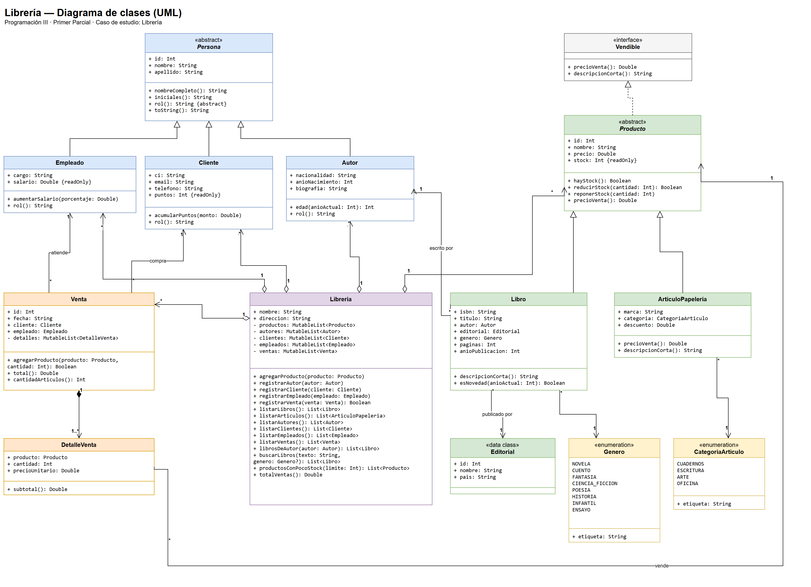

# Checkpoint 1 – Diseño de clases

**Caso de estudio:** Librería

> Archivo editable: [`diagrama_clases_libreria.drawio`](diagrama_clases_libreria.drawio) (se abre en <https://app.diagrams.net> o en la aplicación de draw.io).

## Análisis del problema

Una librería vende **libros** y **artículos de papelería**. Necesita registrar a los **autores** de los libros y sus
**editoriales**, a sus **clientes** (que acumulan puntos) y a sus **empleados**, que atienden las **ventas**. Cada
venta tiene varios **detalles** (producto + cantidad) y al venderse se descuenta el stock.

## Clases

| Clase | Tipo | Responsabilidad |
|---|---|---|
| `Vendible` | interfaz | Contrato de todo lo vendible: `precioVenta()` y `descripcionCorta()`. |
| `Persona` | abstracta | Datos comunes (`id`, `nombre`, `apellido`), `nombreCompleto()`, `iniciales()` y el método abstracto `rol()`. |
| `Autor` | hereda de `Persona` | Nacionalidad, año de nacimiento, biografía; calcula su `edad()`. |
| `Cliente` | hereda de `Persona` | CI, email, teléfono y `puntos` (solo cambian con `acumularPuntos()`). |
| `Empleado` | hereda de `Persona` | Cargo y `salario` (solo cambia con `aumentarSalario()`). |
| `Producto` | abstracta, implementa `Vendible` | `id`, `nombre`, `precio`, `stock`; controla el inventario (`hayStock`, `reducirStock`, `reponerStock`). |
| `Libro` | hereda de `Producto` | ISBN, autor, editorial, género, páginas, año; `esNovedad()`. |
| `ArticuloPapeleria` | hereda de `Producto` | Marca, categoría y descuento; **sobrescribe** `precioVenta()` aplicando el descuento. |
| `Editorial` | data class | Nombre y país de la editorial. |
| `Genero` | enum | Géneros literarios (Novela, Cuento, Fantasía…). |
| `CategoriaArticulo` | enum | Categorías de papelería (Cuadernos, Escritura, Arte, Oficina). |
| `DetalleVenta` | clase | Producto + cantidad + precio unitario congelado; `subtotal()`. |
| `Venta` | clase | Cliente, empleado y detalles; `agregarProducto()`, `total()`, `cantidadArticulos()`. |
| `Libreria` | clase raíz | Agrupa productos, autores, clientes, empleados y ventas; búsquedas y listados para la interfaz. |

## Relaciones

| Relación | Tipo UML | Multiplicidad |
|---|---|---|
| `Autor`, `Cliente`, `Empleado` → `Persona` | Herencia (generalización) | — |
| `Libro`, `ArticuloPapeleria` → `Producto` | Herencia (generalización) | — |
| `Producto` → `Vendible` | Realización (implementa interfaz) | — |
| `Libro` → `Autor` ("escrito por") | Asociación | `*` libros – `1` autor |
| `Libro` → `Editorial` ("publicado por") | Asociación | `*` – `1` |
| `Libro` → `Genero` / `ArticuloPapeleria` → `CategoriaArticulo` | Asociación | `*` – `1` |
| `Venta` ◆→ `DetalleVenta` | Composición (el detalle no existe sin su venta) | `1` – `1..*` |
| `DetalleVenta` → `Producto` ("vende") | Asociación | `*` – `1` |
| `Venta` → `Cliente` ("compra") / `Venta` → `Empleado` ("atiende") | Asociación | `*` – `1` |
| `Libreria` ◇→ `Producto`, `Autor`, `Cliente`, `Empleado`, `Venta` | Agregación | `1` – `*` |

## Conceptos de POO aplicados

- **Abstracción:** `Persona` y `Producto` son abstractas; `Vendible` es una interfaz.
- **Herencia:** jerarquías `Persona` y `Producto`.
- **Polimorfismo:** `rol()` distinto en cada persona; `precioVenta()` y `descripcionCorta()` cambian entre `Libro` y `ArticuloPapeleria`.
- **Encapsulamiento:** `stock`, `puntos` y `salario` tienen `private set`; las listas internas de `Libreria` y `Venta` son privadas y se exponen como `List` de solo lectura.
