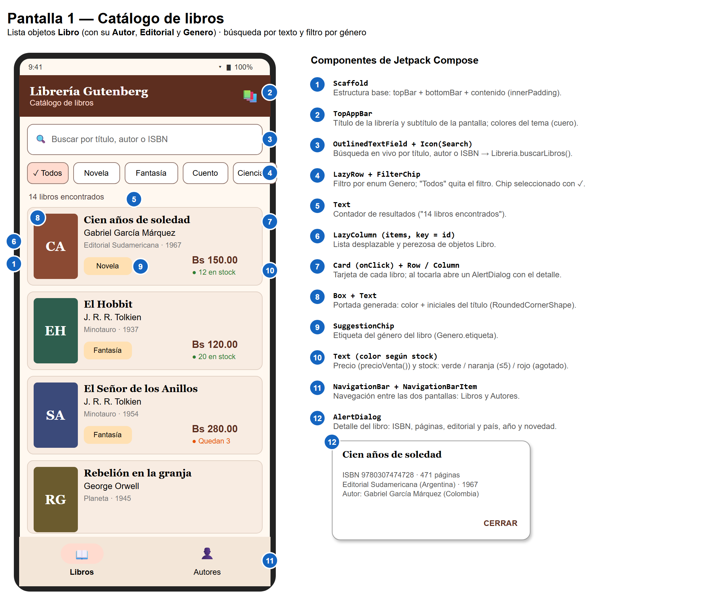
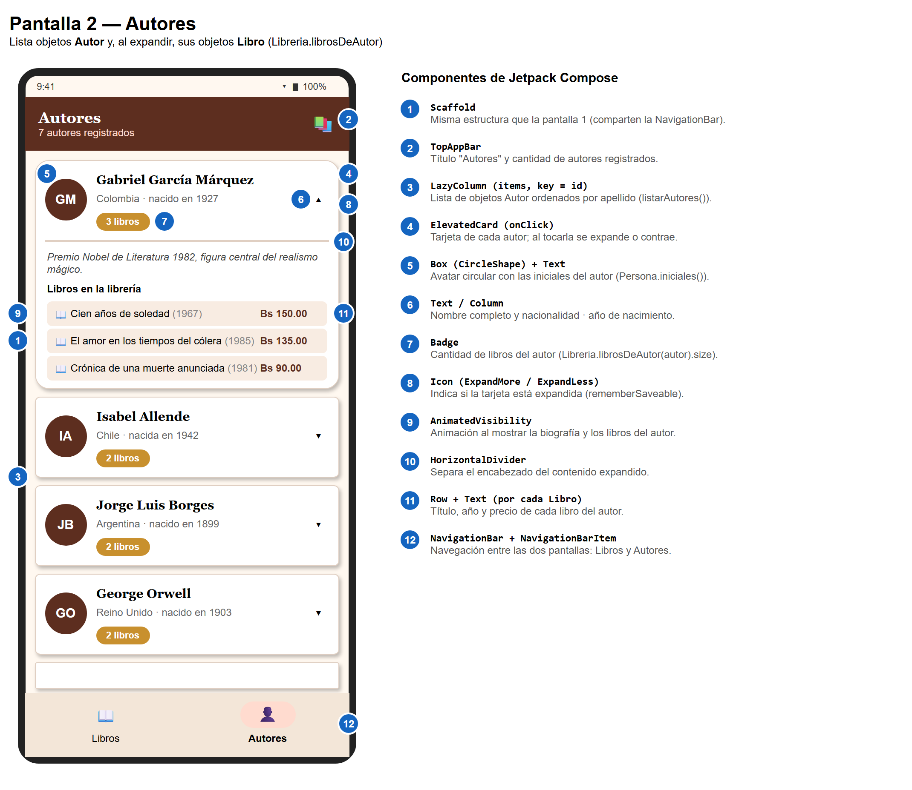

# Checkpoint 4 – Diseño de interfaz

Dos pantallas que listan objetos del modelo. Cada número azul del boceto corresponde a un componente de
**Jetpack Compose** (Material 3) descrito en la tabla.

> Archivos editables: [`pantalla1_libros.drawio`](pantalla1_libros.drawio) y
> [`pantalla2_autores.drawio`](pantalla2_autores.drawio) (abrir en <https://app.diagrams.net>).

## Pantalla 1 — Catálogo de libros (objetos `Libro`)

| # | Componente Compose | Uso en la pantalla |
|---|---|---|
| 1 | `Scaffold` | Estructura base con `topBar`, `bottomBar` y contenido con `innerPadding`. |
| 2 | `TopAppBar` | Nombre de la librería y subtítulo de la pantalla. |
| 3 | `OutlinedTextField` + `Icon(Icons.Default.Search)` | Búsqueda en vivo por título, autor o ISBN (`Libreria.buscarLibros`). |
| 4 | `LazyRow` + `FilterChip` | Filtro por `Genero`; "Todos" quita el filtro. |
| 5 | `Text` | Cantidad de resultados. |
| 6 | `LazyColumn` (`items(key = { it.id })`) | Lista perezosa de libros. |
| 7 | `Card(onClick)` + `Row` / `Column` | Tarjeta de cada libro. |
| 8 | `Box` + `Text` | Portada generada (color + iniciales del título). |
| 9 | `SuggestionChip` | Género del libro. |
| 10 | `Text` con color según stock | Precio (`precioVenta()`) y stock: verde, naranja (≤ 5) o rojo (agotado). |
| 11 | `NavigationBar` + `NavigationBarItem` | Cambia entre "Libros" y "Autores". |
| 12 | `AlertDialog` | Detalle del libro al tocar una tarjeta. |

## Pantalla 2 — Autores (objetos `Autor` y sus `Libro`)

| # | Componente Compose | Uso en la pantalla |
|---|---|---|
| 1 | `Scaffold` | Misma estructura; comparte la barra de navegación. |
| 2 | `TopAppBar` | Título "Autores" y cantidad registrada. |
| 3 | `LazyColumn` (`items(key = { it.id })`) | Autores ordenados por apellido (`Libreria.listarAutores`). |
| 4 | `ElevatedCard(onClick)` | Tarjeta de cada autor; se expande o contrae al tocarla. |
| 5 | `Box(CircleShape)` + `Text` | Avatar circular con `Persona.iniciales()`. |
| 6 | `Text` / `Column` | Nombre completo, nacionalidad y año de nacimiento. |
| 7 | `Badge` | Cantidad de libros del autor (`Libreria.librosDeAutor`). |
| 8 | `Icon(ExpandMore / ExpandLess)` | Indicador de expansión (estado con `rememberSaveable`). |
| 9 | `AnimatedVisibility` | Muestra con animación la biografía y los libros. |
| 10 | `HorizontalDivider` | Separador del contenido expandido. |
| 11 | `Row` + `Text` por cada `Libro` | Título, año y precio de cada libro del autor. |
| 12 | `NavigationBar` + `NavigationBarItem` | Cambia entre "Libros" y "Autores". |

## Navegación y estado

- `LibreriaApp` contiene el `Scaffold` y guarda la pestaña seleccionada en `rememberSaveable` (enum `Pantalla`).
- El texto de búsqueda, el género seleccionado, el libro abierto en el diálogo y los autores expandidos se guardan
  con `remember` / `rememberSaveable`; las listas se calculan con `remember(...)` a partir de la `Libreria`.
- Tema propio `LibreriaTheme` (Material 3) con colores "cuero, papel y dorado" y soporte de modo oscuro.
