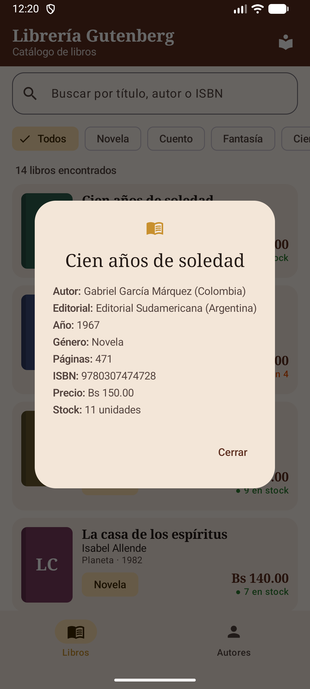
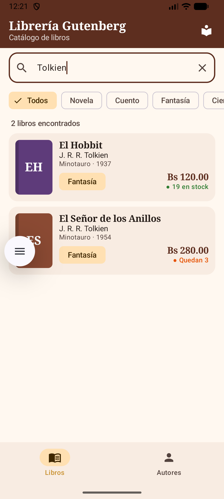
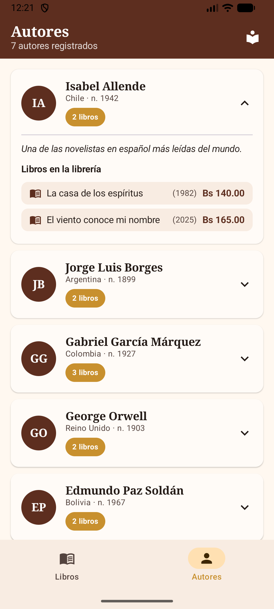

# Checkpoint 6 – Compilación y ejecución

## Entorno

| | |
|---|---|
| IDE / JDK | Android Studio (JBR 25) |
| Gradle / AGP | Gradle 9.6.0 · Android Gradle Plugin 9.5.1 (Kotlin integrado, Kotlin 2.2.10) |
| Compose | Compose BOM 2026.02.01 · Material 3 |
| SDK | `compileSdk` / `targetSdk` 37 · `minSdk` 26 |
| Emulador | AVD *Medium Phone API 37* (`sdk_gphone64_x86_64`, Android 17) |

## 1. Compilar y ejecutar las pruebas

```powershell
powershell -ExecutionPolicy Bypass -File scripts\compilar.ps1
# equivalente a: .\gradlew.bat clean assembleDebug testDebugUnitTest
```

Resultado:

```
> Task :app:assembleDebug
> Task :app:testDebugUnitTest
BUILD SUCCESSFUL
==> APK generado: app\build\outputs\apk\debug\app-debug.apk (18.13 MB)
```

Pruebas unitarias del modelo ([`LibreriaTest.kt`](../../app/src/test/java/com/upb/libreria/LibreriaTest.kt)):
**4 pruebas, 0 fallos**. Cubren el polimorfismo de `rol()` y `precioVenta()`, el control de stock en `Venta`
y la carga/búsqueda de datos de la `Libreria`.

## 2. Ejecutar en el emulador

```powershell
powershell -ExecutionPolicy Bypass -File scripts\ejecutar_emulador.ps1
```

El script inicia el AVD, instala el APK (`adb install -r`), abre `com.upb.libreria/.MainActivity`, interactúa con la
app mediante `uiautomator` + `adb shell input` y guarda las capturas de esta carpeta.

También se puede ejecutar desde Android Studio con **Run ▶ 'app'** sobre cualquier emulador o dispositivo con Android 8.0+.

## Capturas (emulador Android 17)

| Pantalla 1 – Libros | Detalle (`AlertDialog`) | Búsqueda "Tolkien" | Pantalla 2 – Autores |
|---|---|---|---|
|  |  |  |  |

> En la captura de búsqueda, el botón flotante "≡" a la izquierda es del teclado del emulador
> (se escribió con `adb shell input text`), no de la aplicación.
